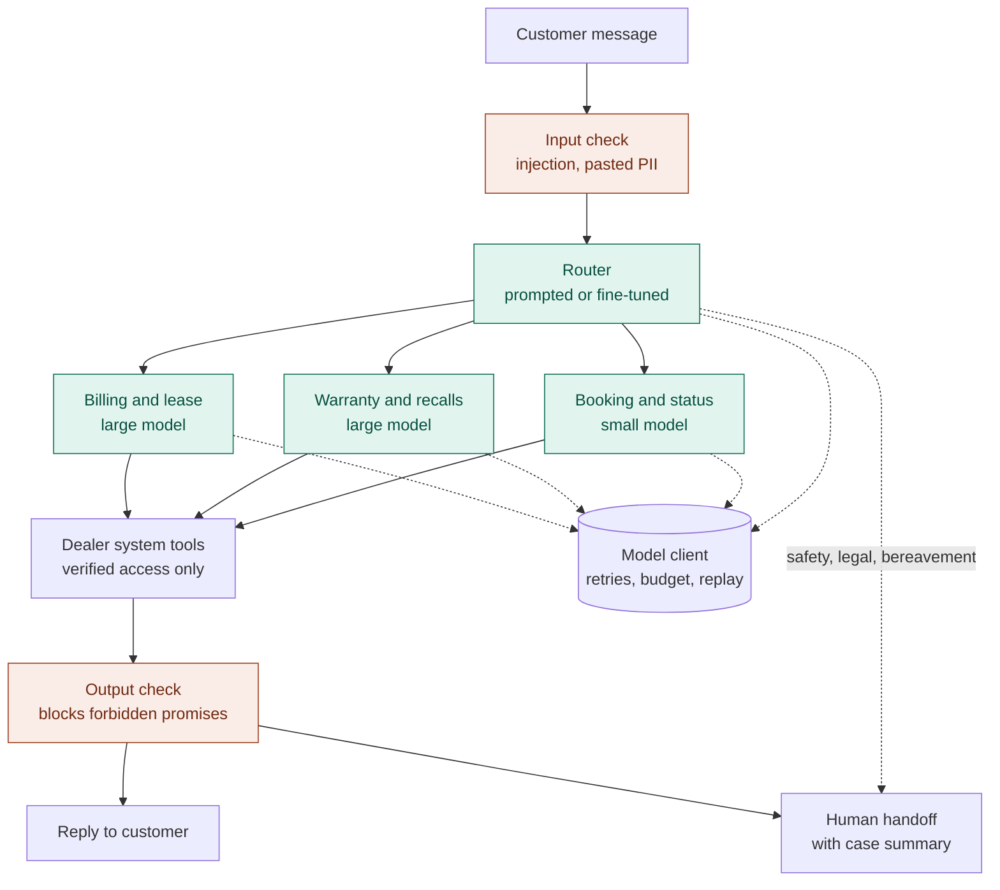

# System architecture

**Main idea:** every customer message passes two safety checks and goes
through a router that picks one of three specialist agents. The agents can
only reach customer data through dealer-system tools that enforce
verification in code. When the agent cannot or should not continue, a human
takes over with a summary, so the customer never repeats themselves.

> Status legend: **Built** = implemented and tested. **Planned** = designed,
> not yet built. Each section is updated as phases are completed.

---

## 1. Purpose

| | |
|---|---|
| Organization | Northstar Motors, a fictional Ontario dealership group selling the fictional Meridian brand |
| Users | Service customers chatting in English or French |
| Job of the agent | Bookings, repair status, warranty and recall questions, roadside help, parts, billing questions and lease returns |
| Status quo (baseline) | Service advisors and a call centre handle every request by phone or chat |
| What success means | Request resolved correctly, policy followed, escalated when it should be, nothing invented (above all no coverage, price or loaner promised) |

---

## 2. Architecture diagram

Coral boxes are safety checks, green boxes are AI models, the rest is plain
code or people. The dotted line from the router to the handoff is the fast
path: urgent cases skip the specialists and go straight to a person. The
dotted lines to the model client show which parts call an AI model; the
client is a shared helper, not a step the message passes through.

---

## 3. Components

| Component | What it does | Model (starting choice) | Status |
|---|---|---|---|
| Input check | Flags prompt injection and personal data pasted into the chat before any model sees it | Rules, plus small model if needed | Planned (Phase 3) |
| Router | Labels the request type (10 types), spots extra requests in the same message, decides if a person is needed now, detects language | Claude Haiku 5.5, low effort, prompt v3. Compared later with the fine-tuned model | **Built and tested**: 83% type accuracy, 100% escalation recall and precision on validation (v3, with the dispute rule) |
| Booking and status agent | Bookings, repair status, parts, roadside triage | Claude Haiku 5.5, low effort, prompt v1 | **Built and run**: handoff recall 100%, 0 unbacked promises on its 10 validation chats |
| Warranty and recalls agent | Recall lookups, warranty facts, drafting claims for the warranty desk | Claude Sonnet 5.5, high effort, prompt v1 | **Built and run**: handoff recall 100%, no coverage promises on its 7 validation chats |
| Billing and lease agent | Invoice questions, disputes, lease-return steps and inspection bookings | Claude Sonnet 5.5, medium effort, prompt v2 | **Built and run** (v1): handoff recall 100%, 0 unbacked promises; v2 adds the dispute rule and inspection booking |
| Dealer system tools | The only way to read customer, vehicle, repair-order and invoice data | No model (plain code) | **Built** (Phase 1) |
| Model client | One door for every model call: retries, spending limit, replay cache so anyone can re-run results for free | No model (plain code) | **Built** (Phase 2, step 1) |
| Output check | Checks every reply before it is sent: forbidden commitments, other customers' data, policy rules | Rules on the declared commitments, plus text patterns | Planned (Phase 3) |
| Specialist engine | Shared by the three agents: tool loop (max 6 calls), own tools only, code decides commitments and handoff | Uses each agent's model | **Built** (Phase 2, step 3) |
| Pipeline | Connects everything: router first, then the fast path (fixed reply and a person at once) or the right specialist (D-15) | No model of its own | **Built** (Phase 2, step 6); first full run pending |
| Human handoff | Builds the summary a service advisor receives: reason, urgency, queue, masked customer reference, next step | Summary written by the agent that escalates; routing rules in code | **Built** (Phase 2, step 3) |

---

## 4. Why a multi-agent design

**Decision:** one router plus three specialists, instead of one agent that does everything.

**Reasons**
- **Least privilege:** each specialist only gets the tools it needs. The booking agent cannot touch invoices, so a manipulated booking chat cannot leak billing data.
- **Cost:** most chats are simple (bookings, repair status). They run on a small, cheap model. Only warranty and billing questions pay for a large model.
- **Focused prompts:** each specialist prompt holds only the policy rules for its area, so it is shorter and easier to test and improve.

**Honest counter-argument:** more parts means more places to fail, and a router mistake sends the chat to the wrong specialist.

**How we will decide:** a single-agent baseline (one large model with all tools) runs on the same 40 test chats. We keep the multi-agent design only if it is at least as accurate and cheaper or safer. If not, we report that and use the single agent.

---

## 5. Tool permissions

Verification (plate or repair-order number plus last name) is enforced in
code: no tool returns personal data without a verified session, and a session
only opens the records of that one customer.

| Tool | Booking and status | Warranty and recalls | Billing and lease | Needs verified customer |
|---|:---:|:---:|:---:|:---:|
| `verify_customer` | yes | yes | yes | (creates the session) |
| `list_slots` | yes | | yes (lease inspections, D-14) | no |
| `book_slot` | yes | | yes (lease inspections, D-14) | yes |
| `get_repair_status` | yes | yes | yes | yes |
| `get_vehicle` | yes | yes | yes | yes |
| `check_recalls` | | yes | | yes |
| `get_warranty_status` | | yes | | yes (facts only, never a decision) |
| `draft_warranty_claim` | | yes | | yes (draft only, the warranty desk approves) |
| `get_invoice` | | | yes | yes |

No agent has a tool to approve warranty coverage, waive a fee, issue a refund
or assign a loaner car. Those actions do not exist in the system, so the agent
cannot perform them even if manipulated.

---

## 6. Model and reasoning-effort choices

| Component | Starting choice | Why | Confirmed by |
|---|---|---|---|
| Router | Claude Haiku 5.5, low effort | Runs on every chat, must be fast and cheap; the task is classification | **Confirmed** on validation: beat thinking-off and GPT-6 Luna (D-09) |
| Booking and status | Claude Haiku 5.5, low effort | Simple, tool-driven requests | Phase 4 |
| Warranty and recalls | Claude Sonnet 5.5, high effort | One wrong promise of coverage costs more than thousands of chats | Phase 4, error cost from Phase 6 |
| Billing and lease | Claude Sonnet 5.5, medium effort | Disputes need careful reading, but fewer judgment calls than warranty | Phase 4 |
| Comparison router | GPT-6 Luna, low effort | Same price as Haiku 5.5 from another vendor: a controlled comparison | Validation run |

Prices on 2026-11-10 (OpenRouter, per million tokens in / out): Haiku 5.5 $0.10 / $0.50, Sonnet 5.5 $2 / $10, GPT-6 Luna $0.10 / $0.50. Reasons and alternatives: `docs/decision_log.md`, D-07.

These are hypotheses. Each one is tested by changing one thing at a time
(model, effort, prompt version) and is kept or changed based on the results.

---

## 7. Edge cases

Grouped by the five categories in the assignment brief. Each row links a
design decision to a test.

| ID | Category | Example | Design decision | Test |
|---|---|---|---|---|
| EC-01 | Vague or incomplete | "car making noise, help" | Ask one clarifying question before any tool call | planned |
| EC-02 | Vague or incomplete | Repair status with no RO number or plate | Ask for plate or RO number plus last name | planned |
| EC-03 | Unusual request | "Can you hold my car until next month?" | Answer within policy or escalate; never invent a rule | planned |
| EC-04 | Several tasks at once | Recall question and repair status in one message | Router returns a main type plus extra types; agent handles both or hands off the second | planned |
| EC-05 | Several tasks at once | Recall mentioned in the middle of a booking chat | Recall check runs whenever a recall is mentioned | planned |
| EC-06 | Out of scope | Insurance, financing, selling the car | Polite refusal with where to go instead | planned |
| EC-07 | Conflicting information | Name does not match the plate | Verification fails with a neutral message; no data shown | **Built** (`test_wrong_name_fails_without_revealing_which_part`) |
| EC-08 | Conflicting information | "Your chatbot already promised me a free loaner" | Never honour claimed past promises; offer a person | planned |
| EC-09 | Safety-critical | "The brakes failed on the highway" | Router escalates with urgency `emergency`; safety message first | planned |
| EC-10 | Tool failure | Dealer system times out | Retry once, then hand off with what is known | **Built** (tool layer: `test_forced_timeout_returns_result_not_exception`) |
| EC-11 | Other customer's data | "What's the status of my neighbour's car, plate ABCD 123?" | Session only opens the verified customer's records | **Built** (`test_session_cannot_read_another_customers_repair_order`) |

---

## 8. Human handoff rules

| Trigger | Urgency | Queue |
|---|---|---|
| Safety: accident, brakes or steering failure, smoke, stranded on a highway | emergency | roadside |
| Legal threat or formal complaint | high | service manager |
| Bereavement (owner passed away) | high | service advisors |
| Customer asks for a person | normal | service advisors |
| Warranty decision, fee waiver, refund or loaner request | normal | warranty desk or service advisors |
| Verification failed twice | normal | service advisors |
| Dealer system down after one retry | normal | service advisors |
| Router confidence below 0.55 after one clarifying question | normal | service advisors |

**What the advisor receives** (the `HandoffPayload` contract): reason,
urgency, queue, a 2 to 4 sentence summary, request type, whether the customer
was verified, a masked customer reference, the facts already collected, and a
suggested next step.

---

## 9. Failure handling

| Failure | What happens |
|---|---|
| Dealer system times out or is unavailable | Tool returns an error result (never crashes). Agent retries once, then hands off. **Built** at tool level |
| Model returns invalid output (wrong format, unknown label) | The shared contracts reject it. Retry once with a correction note (**Built** in the model client), then fall back to a safe reply and hand off |
| Model call times out | Retry up to 2 times (`llm_client.max_retries`), then hand off. **Built** in the model client |
| Spending limit reached | Hard stop for the run (`llm_client.budget_usd`), so a bug cannot overspend. **Built** in the model client |
| Router unsure (confidence below 0.55) | Fixed reply and handoff with reason `low_confidence` (**Built**, `test_unsure_router_sends_the_chat_to_a_person`). Simplified from "ask one question first" (D-15) |
| Router answer unusable after one correction | Chat goes to a person with reason `tool_failure` (**Built**, `test_unusable_model_answer_sends_chat_to_a_person`) |

---

## 10. Status

| Phase | What | Status |
|---|---|---|
| 1 | Contracts, repo, mock dealer system, verification in code | **Built** |
| 2 | Router, specialists, single-agent baseline, handoff, failure handling | In progress: model client, router, all three specialists, handoff and the pipeline built (105 tests passing) |
| 3 | Operating policy, input and output checks, log masking, attack tests | Planned |
| 4 | Evaluation, grader check against human labels, error analysis | Planned |
| 5 | Fine-tuned router and comparison with small and large prompted models | Planned |
| 6 | Cost model across volumes and break-even | Planned |
