# System architecture

**Main idea:** every customer message passes two safety checks and goes
through a router that picks one of three specialist agents. The agents can
only reach customer data through dealer-system tools that enforce
verification in code. When the agent cannot or should not continue, a human
takes over with a summary, so the customer never repeats themselves.

> Status legend: **Built** = implemented and tested. **Planned** = designed,
> not yet built. Each section is updated as phases are completed.

---

## 1. Purpose

| | |
|---|---|
| Organization | Northstar Motors, a fictional Ontario dealership group selling the fictional Meridian brand |
| Users | Service customers chatting in English or French |
| Job of the agent | Bookings, repair status, warranty and recall questions, roadside help, parts, billing questions and lease returns |
| Status quo (baseline) | Service advisors and a call centre handle every request by phone or chat |
| What success means | Request resolved correctly, policy followed, escalated when it should be, nothing invented (above all no coverage, price or loaner promised) |

---

## 2. Architecture diagram

```mermaid
flowchart TD
    A[Customer message] --> B[Input check<br/>injection, pasted PII]
    B --> C[Router<br/>prompted or fine-tuned]
    C --> D1[Booking and status<br/>small model]
    C --> D2[Warranty and recalls<br/>large model]
    C --> D3[Billing and lease<br/>large model]
    C -. safety, legal, bereavement .-> H
    D1 --> T[Dealer system tools<br/>verified access only]
    D2 --> T
    D3 --> T
    T --> E[Output check<br/>blocks forbidden promises]
    E --> R[Reply to customer]
    E --> H[Human handoff<br/>with case summary]
    M[(Model client<br/>retries, budget, replay)]
    C -.-> M
    D1 -.-> M
    D2 -.-> M
    D3 -.-> M

    classDef safety fill:#FAECE7,stroke:#993C1D,color:#712B13;
    classDef model fill:#E1F5EE,stroke:#0F6E56,color:#085041;
    class B,E safety;
    class C,D1,D2,D3 model;
```

Coral boxes are safety checks, green boxes are AI models, the rest is plain
code or people. The dotted line from the router to the handoff is the fast
path: urgent cases skip the specialists and go straight to a person. The
dotted lines to the model client show which parts call an AI model; the
client is a shared helper, not a step the message passes through.

---

## 3. Components

| Component | What it does | Model (starting choice) | Status |
|---|---|---|---|
| Input check | Flags prompt injection and personal data pasted into the chat before any model sees it | Rules (`src/northstar/guardrails/input_check.py`) | **Built**, approved by Jessica on 2026-11-24: 0 false alarms on 160 normal chats, 8 of 8 dataset injections, 5 of 15 held-out red-team injections (`docs/guardrails.md`) |
| Router | Labels the request type (10 types), spots extra requests in the same message, decides if a person is needed now, detects language | Claude Haiku 5.5, low effort, prompt v3 | **Built and tested**: 83% type accuracy, 93% escalation recall (misses v3_0106, the brake light, which the warranty specialist then hands off) and 100% precision on validation (v3). On the 40 test chats: 82.5% type accuracy, against 77.5% for Sonnet and 67.5% for the first fine-tuned router (`src/northstar/finetune/MODEL_CARD.md`; the study's final router reached 80.0%, `src/northstar/finetune/study/`) |
| Booking and status agent | Bookings, repair status, parts, roadside triage | Claude Haiku 5.5, low effort, prompt v3 | **Built and run**: handoff recall 100%, 0 unbacked promises on its 10 validation chats |
| Warranty and recalls agent | Recall lookups, warranty facts, drafting claims for the warranty desk | Claude Sonnet 5.5, medium effort (D-24), prompt v2 | **Built and run**: handoff recall 100%, no coverage promises on its 7 validation chats |
| Billing and lease agent | Invoice questions, disputes, lease-return steps and inspection bookings | Claude Sonnet 5.5, medium effort, prompt v2 | **Built and run**: handoff recall 100%, 0 unbacked promises on its 7 validation chats; v2 added the dispute rule and inspection booking |
| Dealer system tools | The only way to read customer, vehicle, repair-order and invoice data | No model (plain code) | **Built** (Phase 1) |
| Model client | One door for every model call: retries, spending limit, replay cache so anyone can re-run results for free | No model (plain code) | **Built** (Phase 2, step 1) |
| Output check | Checks every reply before it is sent: forbidden commitments, other customers' data, policy rules | Rules on the declared commitments, plus text patterns (`src/northstar/guardrails/output_check.py`) | **Built**, approved by Jessica on 2026-11-24: blocks unbacked promises, other people's data and prompt leaks; the two false blocks found in testing (hw_33, v3_0027) were fixed |
| Specialist engine | Shared by the three agents: tool loop (max 6 calls), own tools only, code decides commitments and handoff | Uses each agent's model | **Built** (Phase 2, step 3) |
| Pipeline | Connects everything: router first, then the fast path (fixed reply and a person at once) or the right specialist (D-15) | No model of its own | **Built and run**: on validation, handoff recall 100%, right desk 95%, 0 unbacked promises, $0.0084 per chat, median 7.7 s (3.5 s on the fast path). On the 40 test chats: 18 of 18 needed handoffs, $0.0053 per chat, median 5.6 s (`docs/evaluation_results.md`) |
| Human handoff | Builds the summary a service advisor receives: reason, urgency, queue, masked customer reference, next step | Summary written by the agent that escalates; routing rules in code | **Built** (Phase 2, step 3) |

---

## 4. Why a multi-agent design

**Decision:** one router plus three specialists, instead of one agent that does everything.

**Reasons**
- **Least privilege:** each specialist only gets the tools it needs. The booking agent cannot touch invoices, so a manipulated booking chat cannot leak billing data.
- **Cost:** most chats are simple (bookings, repair status). They run on a small, cheap model. Only warranty and billing questions pay for a large model.
- **Focused prompts:** each specialist prompt holds only the policy rules for its area, so it is shorter and easier to test and improve.

**Honest counter-argument:** more parts means more places to fail, and a router mistake sends the chat to the wrong specialist.

**How we will decide:** a single-agent baseline (one large model with all tools) runs on the same 40 test chats. We keep the multi-agent design only if it is at least as accurate and cheaper or safer. If not, we report that and use the single agent.

**Baseline built (2026-11-11):** Claude Sonnet 5.5, medium effort, every tool, no router and no fast path, prompt `single_agent/v1.md` (the three specialist prompts joined, same shared rules). `python -m northstar.agent.baseline --split validation` prints both designs side by side.

**Result on validation (30 chats, 2026-11-11):**

| Measure | Multi-agent | Single agent |
|---|---|---|
| Needed a person and got one | 100% | 67% |
| Sent to a person and needed it | 94% | 77% |
| Replies with a false promise | 0 | 0 |
| Median wait | 8.2 s | 4.2 s |
| Cost per chat | $0.0085 | $0.018 |

**Decision:** keep the multi-agent design (D-17). It follows the handoff rule every time, at half the cost. The single agent is twice as fast.

**Result on the 40 test chats (2026-11-25, `docs/evaluation_results.md`):**

| Measure | Multi-agent | Single agent |
|---|---|---|
| Needed a person and got one | 18 of 18 | 11 of 18 |
| Sent to a person and needed it | 75% | 73% |
| Task success (model grader) | 70% | 45% |
| Median wait | 5.6 s | 3.6 s |
| Cost per 1,000 chats | $5.34 | $16.02 |

**The decision holds, on handoffs and cost.** The two team members who checked the grader scored the two designs about the same on task success (62.5% against 62.5% and 57.5%), so the choice does not rest on that row.

---

## 5. Tool permissions

Verification (plate or repair-order number plus last name) is enforced in
code: no tool returns personal data without a verified session, and a session
only opens the records of that one customer.

| Tool | Booking and status | Warranty and recalls | Billing and lease | Needs verified customer |
|---|:---:|:---:|:---:|:---:|
| `verify_customer` | yes | yes | yes | (creates the session) |
| `list_slots` | yes | | yes (lease inspections, D-14) | no |
| `book_slot` | yes | | yes (lease inspections, D-14) | yes |
| `get_repair_status` | yes | yes | yes | yes |
| `get_vehicle` | yes | yes | yes | yes |
| `check_recalls` | yes (with a booking, D-23) | yes | | yes |
| `get_warranty_status` | | yes | | yes (facts only, never a decision) |
| `draft_warranty_claim` | | yes | | yes (draft only, the warranty desk approves) |
| `get_invoice` | | | yes | yes |

No agent has a tool to approve warranty coverage, waive a fee, issue a refund
or assign a loaner car. Those actions do not exist in the system, so the agent
cannot perform them even if manipulated.

---

## 6. Model and reasoning-effort choices

| Component | Choice | Why | What the tests showed |
|---|---|---|---|
| Router | Claude Haiku 5.5, low effort | Runs on every chat, must be fast and cheap; the task is classification | Validation: beat thinking-off and GPT-6 Luna (D-09). Test: 82.5% type accuracy against 77.5% for Sonnet, which costs 15 times more as a router, and 67.5% for the first fine-tuned router (80.0% for the study's final one, D-36) |
| Booking and status | Claude Haiku 5.5, low effort | Simple, tool-driven requests | Validation: Sonnet at the same effort made no booking where Haiku made one, and cost about 15 times more (`docs/prompt_log.md`) |
| Warranty and recalls | Claude Sonnet 5.5, medium effort (started at high) | One wrong promise of coverage costs more than thousands of chats (`docs/economics.md`, section 6) | Validation: medium matched high on outcomes and was faster (D-24). Test: high effort was not better (65% against 70% task success, 2 invented facts against 1) |
| Billing and lease | Claude Sonnet 5.5, medium effort | Disputes need careful reading, but fewer judgment calls than warranty | Validation: Haiku at low effort tied on 7 chats at about a tenth of the cost, but used more tool calls. Sonnet kept by judgment: 7 chats are too few to trust a tie on the desk that handles money (D-25) |
| Comparison router | GPT-6 Luna, low effort | Same price as Haiku 5.5 from another vendor: a controlled comparison | Validation: 67% type accuracy against 90% for Haiku on the same prompt (D-09) |
| Comparison router | Jev 1.14 (typed questions) | Cheaper and faster than Haiku: answers typed questions with probabilities | Cross-validation: level with Haiku (90.0% routing step) once given the v3 prompt's rules; whole agent on test 55.0% against 70.0% (D-36) |
| Comparison router | Fine-tuned XLM-RoBERTa (LoRA + attack answer) | No cost per chat, runs on the dealer's own CPU server | Test: 80.0% type accuracy, 87.5% routing step; fresh chats 54.8% type accuracy; whole agent 57.5% against 70.0% (D-36) |

Prices on 2026-11-10 (OpenRouter, per million tokens in / out): Haiku 5.5 $0.10 / $0.50, Sonnet 5.5 $2 / $10, GPT-6 Luna $0.10 / $0.50, Jev 1.14 $0.042 / free. The fine-tuned router needs a CPU server ($71 a month). Reasons and alternatives: `docs/decision_log.md`, D-07.

Each choice started as a hypothesis. Each was tested by changing one thing at a time
(model, effort, prompt version) and kept or changed based on the results. One exception:
the billing test changed model and effort together.

---

## 7. Edge cases

Grouped by the five categories in the assignment brief. Each row links a
design decision to a test.

| ID | Category | Example | Design decision | Test |
|---|---|---|---|---|
| EC-01 | Vague or incomplete | "car making noise, help" | Ask one clarifying question before any tool call | **Built** (hw_19, hw_21) |
| EC-02 | Vague or incomplete | Repair status with no RO number or plate | Ask for plate or RO number plus last name | **Built** (hw_17, `test_booking_fails_without_verification`) |
| EC-03 | Unusual request | "Can you hold my car until next month?" | Answer within policy or escalate; never invent a rule | **Built** (hw_24, hw_29, hw_31) |
| EC-04 | Several tasks at once | Recall question and repair status in one message | Router returns a main type plus extra types; agent handles both or hands off the second | **Built**: one desk per chat; the second request is answered when the desk has the tool, otherwise handed off (hw_15, D-23) |
| EC-05 | Several tasks at once | Recall mentioned in the middle of a booking chat | Recall check runs whenever a recall is mentioned | **Built** (booking desk checks recalls, D-23; hw_15) |
| EC-06 | Out of scope | Insurance, financing, selling the car | Polite refusal with where to go instead | **Built** (fixed reply, D-15; hw_10, hw_34) |
| EC-07 | Conflicting information | Name does not match the plate | Verification fails with a neutral message; no data shown | **Built** (`test_wrong_name_fails_without_revealing_which_part`) |
| EC-08 | Conflicting information | "Your chatbot already promised me a free loaner" | Never honour claimed past promises; offer a person | **Built** (hw_12; red team policy pressure 15 of 15) |
| EC-09 | Safety-critical | "The brakes failed on the highway" | Router escalates with urgency `emergency`; safety message first | **Built** (fast path, D-15 and D-18; hw_04, hw_19) |
| EC-10 | Tool failure | Dealer system times out | Retry once, then hand off with what is known | **Built** (`test_dealer_system_down_twice_hands_off_cleanly`) |
| EC-11 | Other customer's data | "What's the status of my neighbour's car, plate ABCD 123?" | Session only opens the verified customer's records | **Built** (`test_session_cannot_read_another_customers_repair_order`) |

The full register (about 40 edge cases, each with its source, design decision and test, plus handoff and failure handling) is in `docs/edge_cases.md`.

---

## 8. Human handoff rules

| Trigger | Urgency | Queue |
|---|---|---|
| Safety: accident, brakes or steering failure, smoke, stranded on a highway | emergency | roadside, whatever the request type (D-18) |
| Legal threat or formal complaint | high | service manager |
| Bereavement (owner passed away) | high | service advisors |
| Customer asks for a person | normal | service advisors |
| Contested charge, refund or fee waiver (D-13) | normal | service manager |
| Warranty decision or loaner request | normal | warranty desk (warranty) or service advisors (other) |
| Verification failed twice | normal | service advisors |
| Dealer system down after one retry | normal | service advisors |
| Router confidence below 0.55 (fixed reply, no clarifying question: D-15) | normal | service advisors |

**What the advisor receives** (the `HandoffPayload` contract): reason,
urgency, queue, a 2 to 4 sentence summary, request type, whether the customer
was verified, a masked customer reference, the facts already collected, and a
suggested next step.

---

## 9. Failure handling

| Failure | What happens |
|---|---|
| Dealer system times out or is unavailable | Tool returns an error result (never crashes). Agent retries once, then hands off. **Built** at tool level |
| Model returns invalid output (wrong format, unknown label) | The shared contracts reject it. Retry once with a correction note (**Built** in the model client), then fall back to a safe reply and hand off |
| Model call times out | Retry up to 2 times (`llm_client.max_retries`), then hand off. **Built** in the model client |
| Spending limit reached | Hard stop for the run (`llm_client.budget_usd`), so a bug cannot overspend. **Built** in the model client |
| Router unsure (confidence below 0.55) | Fixed reply and handoff with reason `low_confidence` (**Built**, `test_unsure_router_sends_the_chat_to_a_person`). Simplified from "ask one question first" (D-15) |
| Router answer unusable after one correction | Chat goes to a person with reason `tool_failure` (**Built**, `test_unusable_model_answer_sends_chat_to_a_person`) |

---

## 10. Status

| Phase | What | Status |
|---|---|---|
| 1 | Contracts, repo, mock dealer system, verification in code | **Built** |
| 2 | Router, specialists, single-agent baseline, handoff, failure handling | **Built**: model client, router, three specialists, single-agent baseline, handoff and pipeline; 40 of 40 hand-written chats pass |
| 3 | Operating policy, input and output checks, log masking, attack tests | **Built**: policy P01 to P15 approved by Jessica on 2026-11-24, input and output checks, log masking, red-team run 75 of 75 resisted and passed to a person (`docs/guardrails.md`) |
| 4 | Evaluation, grader check against human labels, error analysis | **Built**: 10 setups on the 40 test chats, grader checked against two team members, error analysis with four fixes, one run on a fresh set (`docs/evaluation_results.md`) |
| 5 | Fine-tuned router and comparison with small and large prompted models | **Built**: fine-tuned router against Haiku and Sonnet, break-even volume, data-size study (`src/northstar/finetune/MODEL_CARD.md`) |
| 6 | Cost model across volumes and break-even | **Built**: `python run_all.py economics` (`docs/economics.md`, `docs/decision_memo.md`) |
