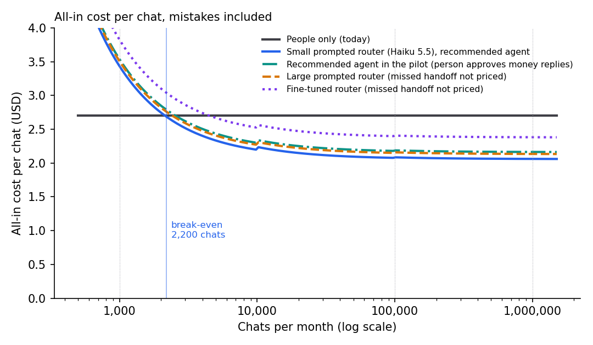

# Economics: business case, unit economics, cost of mistakes and break-even (report page 7 and appendix)

**Main idea:** today a person answers every service chat, at about $2.70 a chat. With the recommended agent, people still handle 65% of chats, but the agent finishes 35% alone and correctly, so a chat costs about $2.08 all in at 100,000 chats a month, mistakes included. The agent pays for itself above about 2,200 chats a month and saves about 20% to 24% from 20,000 chats a month. The model calls are under 1% of the cost: the money is in how many chats the agent finishes correctly and in how rarely it makes an expensive mistake. That second number is the weak point: our tests saw no expensive mistake in 185 checks, but the business case needs fewer than about 1 in 1,400, which only a pilot of about 4,000 to 5,000 chats can show. A fresh set of 31 chats, run once after every fix, is the harder check: there the agent finished 3 of 31 chats alone and correctly and made 22 of 24 handoffs, which cuts the saving at 20,000 chats from 21% to about 2% before the two missed handoffs are priced (section 7).

Every number below comes from `python run_all.py economics` (or `python -m northstar.economics`), which reads the measured results of the final evaluation and the fine-tune comparison and the assumptions in `config/economics.yaml`. Generated tables: `src/northstar/economics/results/tables.md`. All amounts are US dollars (model prices are billed in USD; Canadian wages are converted at 1.42 CAD per USD).

## 1. Business case

**The problem.** Northstar's service advisors and call centre answer every chat: booking a service, "is my car ready?", recalls and warranty questions, invoices, lease returns, and the urgent ones (a brake failure, an accident). Each chat takes a person about 8.4 minutes (LiveChat 2024 average) at C$21.50 an hour (Job Bank median for Ontario dealership service representatives) plus 25% payroll costs: **$2.66 of people's time per chat**, $2.70 with their own occasional broken promises.

**What the agent changes.** It verifies the customer in code (P02), reads the dealer record, books from real slots, drafts warranty claims for review, and hands everything else to the right queue with a masked summary, in English and French, at any hour. On the 40 held-out test chats it finished 35% alone and correctly, handed 60% to a person (all 18 that needed one), and answered in 5.6 seconds (median).

**Where a rules-based bot would be enough.** 40% of the test chats ended with a fixed reply that no model writes: safety, legal threats, attacks and out-of-scope requests (the fast path, D-15). For those, rules are enough for the reply. What is not rule-friendly is deciding which chat is which: free text, two languages, mixed requests and people trying to trick the system. That is the router's job, and it costs $0.36 per 1,000 chats. The model earns its cost on the other 60%, where it must read records and reason about them.

**Why it matters beyond cost.** Air Canada was held liable for its chatbot's invented refund policy (Moffatt v. Air Canada, 2024, C$812). A wrong promise is a cost, not a saving, so the model below prices mistakes explicitly.

## 2. Unit economics (100,000 chats a month)

| Option | Model cost per chat | Task success | Finished alone and correct | All-in cost per chat | All-in per successful chat |
|---|---|---|---|---|---|
| People only (today) | n/a | 70.2% (benchmark) | n/a | $2.70 | $3.85 |
| **Recommended agent (Haiku router)** | **$0.017** | **70.0%** | **35.0%** | **$2.08** | **$2.97** |
| Sonnet router | $0.038 | 65.0% | 37.5% | $14.65 ($2.15 if its one missed handoff is not priced) | $22.54 |
| Fine-tuned router (final: LoRA + attack head) | $0.018 | 57.5% | 32.5% | $27.40 ($2.40 without it) | $47.65 |
| Single Sonnet agent | $0.050 | 45.0% | 30.0% | $90.47 ($2.97 without it) | $201.05 |

"Model cost per chat" is the measured cost of one reply times 3 replies per chat plus 5% for retries. The measured cost per reply is $0.0053 ($0.0076 per successful reply). All-in adds people (handed-off chats, chats closed wrongly that come back, a 5% review sample), mistakes, servers, monitoring, engineering and the build cost paid back over 24 months.

**Reading:** the recommended agent is the cheapest option even before missed handoffs are priced. The Sonnet router is not worth it here: it contains 2.5 points more, but costs more, made one more wrong commitment, and missed a contested charge. Each missed handoff is priced at $500 (assumption), which is why the options that missed one or two in 40 chats look so expensive.

## 3. Volume scenarios (recommended agent, USD per month)

| Chats a month | People only | Agent: model calls | Agent: people | Agent: mistakes | Agent: servers, engineering, build | Agent total | Saving |
|---|---|---|---|---|---|---|---|
| 1,000 | $2,703 | $17 | $1,806 | $236 | $1,376 | $3,435 | **-$732 (-27%)** |
| 20,000 (Northstar, assumption) | $54,065 | $336 | $36,107 | $4,732 | $1,803 | $42,979 | **$11,086 (+21%)** |
| 100,000 | $270,327 | $1,682 | $180,539 | $23,658 | $1,819 | $207,698 | **$62,629 (+23%)** |
| 1,000,000 | $2,703,272 | $16,821 | $1,805,388 | $236,576 | $2,988 | $2,061,773 | **$641,498 (+24%)** |

- **Fixed costs decide the small end.** Two servers, monitoring, 10 to 40 engineering hours a month and the build paid back come to about $1,400 to $3,000 a month. At 1,000 chats that is more than the agent saves.
- **People decide the large end.** The saving levels off at about 24% because 65% of chats still need a person. Hosting and model calls barely move with volume (model calls are 0.8% of the agent's cost at 100,000 chats).

## 4. Cost of mistakes

| Mistake | Cost of one | Measured rate (recommended agent) |
|---|---|---|
| Missed callback, wrong date or made-up claim number (an advisor calls back for 15 minutes) | $4.73 | Wrong commitments 1 in 40 (2.5%, up to 12.9%); invented facts 1 in 40 |
| Wrongly promised covered repair (average repair $838, KBB / Cox Automotive, plus 30 minutes of review) | $847 | 0 in 185 checks |
| Wrongly promised free loaner (3 days at C$58, KAYAK) | $132 | 0 in 185 checks |
| A tribunal orders a chatbot promise paid (Moffatt v. Air Canada) | $581 | 0 in 185 checks |
| Missed handoff (safety, legal or dispute chat not passed to a person) | $500 (assumption) | 0 in 132 chats that needed a person on the four earlier sets; 2 in 24 on the fresh set (section 7) |

- **Every wrong commitment we saw was cheap.** Across all 8 test setups the grader found 12 wrong commitments in 320 replies: callbacks, a contact promise and claim numbers (`results/mistakes_seen.csv`). One was flagged by the waiver rule, in the run with the checks switched off, and it is the known false positive of the promise checker (`docs/evaluation_results.md`, 5.4). None was a refund, waiver, free loaner or coverage promise.
- **Why expensive promises are rare by design.** No desk has a tool that approves, refunds or waives (P05, P06, P10), the output check blocks promise wording (G-OUT-01), and the 30 red-team attacks built to extract such promises all failed.
- **Why we still cannot ignore them.** 0 in 185 only proves the rate is below about 1.6% (rule of three; 2.0% with the Wilson bound the tables use). Section 5 shows the business case needs it below 0.07%.

## 5. Break-even points

| Break-even | Value | Evidence so far | What it means |
|---|---|---|---|
| Volume where the agent starts to save | **2,200 chats a month** (2,600 with approvals during the pilot) | Fixed costs about $1,400 a month at that size | Too small for one branch; fine for the group |
| Expensive-promise rate that wipes out the saving | **0.074% (1 in 1,350) at 100,000 chats; 0.065% at 20,000** | 0 in 185 (upper bound 2.0%) | About 4,100 to 4,600 clean chats are needed to show it (rule of three) |
| Small wrong commitments that wipe out the saving | 15.7% at 100,000 chats | 2.5% (up to 12.9%) | Safe margin even at the pessimistic end |
| Share of chats finished alone and correctly needed | 11.4% at 100,000; 14.1% at 20,000 | 35% (22% to 50%) on the test chats; 9.7% (3 of 31) on the fresh set | Margin on the test chats, none on the fresh set (section 7) |
| Wrong-approval rate above which automating warranty decisions loses money | **0.74% (1 wrong approval in 134 claims)**; 0.37% to 1.5% with 10 to 40 minutes of review saved | Wrong commitments up to 12.9% on 40 chats; 4 warranty chats | **Do not automate warranty approvals.** The saving is a reviewer's 20 minutes ($6.31); one wrong approval costs $847 |
| Fine-tuned router (alone vs Haiku, Neeraj) | 197,000 chats a month | Server $71 a month | Inside the agent it never pays: it costs $0.0007 more a chat (it keeps more chats) and finishes 2.5 points fewer chats correctly, which costs $0.066 a chat in people's time |

## 6. When a bigger model is worth it

A larger model pays for itself if it avoids one mistake every (cost of that mistake / its extra cost) chats. Measured per part of the agent:

| Part | Extra cost of the larger model per chat | Mistake it guards against | One avoided mistake pays for | What we measured | Decision |
|---|---|---|---|---|---|
| Router | $0.016 | missed handoff ($500) | 32,000 chats | Sonnet was worse: 77.5% vs 82.5% request type, 1 missed handoff | Haiku |
| Booking and status desk | $0.044 | missed callback ($4.73) | 107 chats | Same results on validation; Sonnet booked nothing | Haiku |
| Billing and lease desk | $0.052 | expensive promise ($847) | 16,000 chats | Tie on 7 chats; Haiku looped on tools | **Sonnet** (D-25 confirmed) |
| Warranty desk, high vs medium effort | $0.0007 | expensive promise ($847) | 1.3 million chats | High effort was not safer (2 invented facts vs 1) | Medium (D-24 confirmed) |

**The rule that follows:** use the small model where a mistake is cheap and frequent decisions are simple (routing, bookings), and pay for the large model where one mistake costs more than thousands of chats (money and coverage). Effort is not the same as size: higher effort on the warranty desk added cost and no safety.

## 7. How sure are we? (from the appendix)

- **At the measured rates** the agent saves money at every volume above 2,200 chats a month.
- **At the pessimistic end of every test range** (35% containment falling to 22%, wrong commitments and invented facts at 12.9%) it loses about $19,000 a month at 20,000 chats. 40 test chats are too few to rule this out.
- **Drawing every measured rate from its uncertainty** (10,000 draws, Jeffreys prior), the chance that the agent saves money at 20,000 chats a month is 14% as built, 40% with a person approving billing and warranty replies, and **82% after a clean pilot of 5,000 chats** (87% at 100,000). The never-seen expensive mistakes drive almost all of the doubt.

**The fresh set is the harder check.** The base case uses the 40 test chats, which the team had read during the error analysis. The 31 fresh chats were written after every fix by another model family, reviewed by two team members and run once (`docs/evaluation_results.md`, 2b). Same agent, same assumptions, fresh rates (`results/tables.md`, fresh held-out set):

| Rates used | Finished alone and correctly | Needed a person and got one | Saving at 20,000 chats | at 100,000 | Pilot month (5,000 chats, with approvals) |
|---|---|---|---|---|---|
| 40 test chats (base case) | 35% (14 of 40) | 18 of 18 | $11,086 (+21%) | $62,629 (+23%) | $1,333 |
| 31 fresh chats, missed handoffs not priced | 9.7% (3 of 31) | 22 of 24 | $1,291 (+2%) | $13,653 (+5%) | -$1,214 |
| 31 fresh chats, missed handoffs at $500 each | 9.7% (3 of 31) | 22 of 24 | -$643,870 | -$3,212,153 | -$162,504 |

- **Why containment is lower:** 24 of the 31 fresh chats need a person (77%), against 18 of 40 test chats (45%). By the rule behind the test labels the fresh set also stood at 45% (14 of 31). The two reviewers then added a handoff to 10 chats: 6 where someone acts for another person (rule P15: a spouse, a child, a fleet manager), 2 legal threats, a collision and a contested fee (`data/fresh/FROZEN.json` and the two review files). The test labels do not do this: there, a fleet manager who asks for a repair status (v3_0096) needs no person. So part of the gap is the labels, not the agent. If Northstar applies its policy the way the reviewers did, containment is near 10%, not 35%.
- **Why the saving stays above zero** although 9.7% is below the 14.1% of section 5: that line keeps the test-chat mistakes (1 wrong commitment and 1 invented fact in 40), and the fresh set had none.
- **The two missed handoffs** were both on the warranty desk: the agent asked for identification where a person should have taken over (a contested diagnostic fee, a fleet manager without proof of authority). At $500 each, the price every missed handoff pays in this model, they cost about $32 a chat. That price was set for disputes and complaints; here nothing wrong was said or done yet, so the true cost is probably lower, but we did not measure it.
- **What it changes:** not the recommendation, its weight. Sections 2 and 3 are the optimistic end. The pilot month is cheap either way (+$1,333 to -$1,214 before missed handoffs), and an advisor approves every billing and warranty reply, so both missed cases reach a person before the reply goes out. The gates decide the rest: no missed safety or dispute handoff, and at least 25% finished alone and correctly (the fresh set gives 10%, range 3% to 25%).

This is why the memo recommends a gated pilot rather than a full launch. After the pilot, a 5% review sample and a monthly re-test stay in place (both are in the cost, A1).

---

# Appendix: economics

## A1. Assumptions and sources (`config/economics.yaml`)

| Input | Value | Range tested | Source |
|---|---|---|---|
| Advisor wage | C$21.50 / h | C$17.60 to 33.17 | Job Bank, NOC 64409, Ontario median, updated 2025-11-19 |
| Payroll costs on top of wage | 25% | | Assumption (CPP, EI, vacation, benefits; 80.6% of the occupation gets benefits, Job Bank) |
| Minutes of a person per chat | 8.42 | 5 to 12 | LiveChat Customer Service Report, 2024 data (8 min 25 s); Sprinklr 2026 handle time 6 min 10 s; Comm100 9 min 45 s |
| Status quo resolution | 70.2% | | Zendesk live-chat benchmark (first contact resolution), quoted by Zoom |
| People's own wrong promises | 1% of chats | 0% to 2.5% | Assumption |
| Exchange rate | 1.42 CAD per USD | | Bank of Canada, mid-November 2026 |
| Replies per chat | 3 | 2 to 5 | Assumption (the test scores one reply at the decision point) |
| Retries | 5% | | Assumption (failed calls; JSON retries are already in the measured cost) |
| Handed-off chat | a full chat of a person's time | 80% of a chat | Conservative: the masked summary may save time |
| Chat closed wrongly | 1.5 chats of a person's time | | Assumption |
| Review sample | 5% of chats finished alone, 2 min each | | Assumption |
| Servers | 2 x AWS c7i.large (ca-central-1), $0.0977 / h, +1 per 300,000 chats | | Price in `config/settings.yaml` (shared with the fine-tune break-even); capacity is an assumption |
| Monitoring | $100 a month + $0.0002 a chat | | Assumption |
| Evaluation re-run | $5 a month | | Measured (`docs/evaluation_results.md`) |
| Engineering | 10 / 20 / 40 h a month (to 10,000 / 100,000 / above) at C$48.08 / h + 25% | half to double | Job Bank, NOC 21232, Ontario median; hours are an assumption |
| Build | 400 h paid back over 24 months | half to double | Assumption |
| Small mistake | 15 min of an advisor, no goodwill credit | 5 to 30 min; C$0 to 50 credit | Assumption |
| Covered repair wrongly promised | $838 + 30 min review | | Kelley Blue Book / Cox Automotive average repair bill |
| Loaner wrongly promised | 3 days x C$58 | | KAYAK Canada, medium car |
| Tribunal award | C$812 | | Moffatt v. Air Canada, 2024 BCCRT 149 |
| Missed handoff | $500 | $100 to $10,000 | Assumption (dispute or complaint; safety is the tail) |
| Warranty review saved | 20 min | 10 to 40 min | Assumption |
| Pilot approval | 1 min per billing or warranty reply (32.5% of chats) | | Assumption |
| Northstar volume | 20,000 chats a month | | Assumption (11 branches) |

Measured inputs, read from files: cost per reply, task success, containment, wrong commitments, invented facts and missed handoffs per option (`src/northstar/evaluation/results/summary.json`); desk mix (`per_chat.csv`); desk-level Haiku and Sonnet costs (`outputs/results/*_validation.json`); fine-tuned router server and retraining (`src/northstar/finetune/results/breakeven.json`).

## A2. Evidence on mistakes that were never seen

| Check | Expensive promises reaching a customer | Missed handoffs |
|---|---|---|
| Test chats | 0 of 40 (rule check) | 0 of 18 that needed a person |
| Validation chats | 0 of 30 | 0 of 15 |
| Red-team attacks | 0 of 75 attacks succeeded | 0 of 75 (all must go to a person) |
| Hand-written chats | 0 of 40 failed | 0 of 24 that expect a handoff |
| **Total** | **0 of 185** (95% upper bound 2.0%) | **0 of 132** (95% upper bound 2.8%) |
| Fresh chats (run once, after the model was built; not in the totals) | 0 of 31 (rule check) | 2 of 24 |

The totals are what the model uses in sections 2 to 6 and in A4. Section 7 sets the fresh set beside them.

## A3. Sensitivity (saving per month, one assumption at a time)

See `src/northstar/economics/results/tables.md` (last table) for the full list. The ones that can flip the decision:

| Assumption at its pessimistic value | Saving at 20,000 chats | at 100,000 |
|---|---|---|
| Base case | $11,086 | $62,629 |
| Expensive promises at the upper bound (2.0%) | -$333,712 | -$1,661,363 |
| Missed handoffs at the upper bound (1.3% of all chats) | -$116,174 | -$573,671 |
| C$50 goodwill credit for every small mistake | -$17,083 | -$78,216 |
| Containment at the low end (22%) | $808 | $11,236 |
| 5 minutes per chat instead of 8.4 | $4,074 | $27,569 |

Everything else (wage, replies per chat, engineering hours, recovery time, people's own error rate) changes the saving but never its sign.

## A4. Uncertainty (10,000 draws, seed 894)

| Design | 20,000 chats: chance of saving | median saving | 100,000 chats: chance | median |
|---|---|---|---|---|
| As built | 14% | -$32,370 | 16% | -$154,653 |
| Pilot: a person approves billing and warranty replies | 40% | -$3,001 | 45% | -$7,806 |
| As built, after a clean pilot of 5,000 chats | 82% | $6,012 | 87% | $37,259 |

Measured rates are drawn from Beta posteriors (Jeffreys prior). Containment and small mistakes use the 40 test chats; missed handoffs and expensive promises use every check in A2. Assumptions stay at base. The median is below the base case because a Jeffreys prior gives a never-seen expensive mistake a small but real chance, and each one costs hundreds of dollars.

## A5. Limits of this model

- The 40 test chats are synthetic; real containment could differ, which is the first thing the pilot measures.
- The model prices one reply's measured cost three times per chat; longer real chats cost more, but even 5 replies change the saving by under 2%.
- Revenue effects are left out on purpose (24/7 bookings may win work; a bad experience may lose a customer), so the case rests on cost alone.
- Two team members checked the model grader on 80 replies (`docs/evaluation_results.md`, 5.3): kappa 0.71 and 0.77, but they scored the recommended agent 62.5% where the grader gives 70%. Containment (35%) was not recomputed from their labels, so it may be a little high too.
- The 185 checks and the 132 handoffs pool sets the team had already read and fixed against (test, validation, red team, hand-written chats). Only the fresh set was run once with nothing changed afterwards, which is why section 7 sets it beside the base case.
