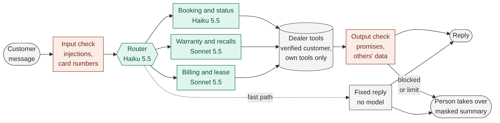

# Page 3. System design, edge cases, agents and prompting

<!-- figure width: 5.6 in -->

**Design.** A router labels each message (10 request types, language, person needed now?). Safety, legal and attack chats take the fast path: a fixed reply that no model writes and a person at once. Out-of-scope chats get a fixed reply too (40% of test chats in all). The rest go to one of three desks, each with only its own tools. The key rules live in code, not only in prompts: identity check before any record, no tool that approves, refunds or edits, bookings only for a time the customer chose.

**Is a multi-agent setup needed?** Against one Sonnet agent with every tool, the router and desks made 18 of 18 needed handoffs against 11 of 18 at a third of the cost ($5.34 against $16.02 per 1,000 chats), and 22 of 24 against 17 of 24 on the fresh chats. The single agent is faster (3.6 s against 5.6 s) and people scored both alike on task success: the choice rests on handoffs and cost.

| Part and choice | Evidence, one change at a time |
|---|---|
| Router: Haiku, low effort | Test: 82.5% of request types right; Sonnet 77.5% at 2.2 times the cost; fine-tuned 67.5% (80.0% after the study, page 4). Validation: thinking off missed a handoff |
| Booking: Haiku, low | Validation: Sonnet booked nothing and cost about 15 times more |
| Warranty: Sonnet, medium | Test: high effort was not better (65% against 70%). Model not compared: it rests on the $847 cost of a wrong promise |
| Billing: Sonnet, medium | Validation: Haiku tied on 7 chats at a tenth of the cost. Sonnet kept by judgment, not by a test |

**Prompts.** Each has a role, steps, examples (router, in English and French) and an answer format the code validates; the policy (P01 to P15) is one file inserted in every desk prompt. Every change is logged with its reason and result: router v2 raised request-type accuracy from 80% to 90% and removed all 5 false alarms. The lesson: a rule that a prompt breaks twice moves into code. Booking v3 still booked times nobody chose, so the code refuses them; at medium effort the warranty desk drafted claims in 4 fraud attempts (red team 71 of 75), so the claim tool is withheld in flagged chats (75 of 75).

**Edge cases, handoff, failure.** The register (`docs/edge_cases.md`) is built from three sources, not ad hoc: the brief's list, the dataset's coverage matrix and failures found in testing. Its 32 edge cases, 7 handoff situations and 8 failures each name a decision and a test: two requests in one message (the booking desk got the read-only recall tool, hw_15); another person's plate with a real repair order (every identifier must match the same car, hw_05, a real gap this chat found). A handoff carries the reason, queue, urgency and a masked summary. Model and tool calls are retried, then a person takes over (hw_35 to hw_37). All 40 hand-written chats pass. Limits: one desk per chat; single-message attacks only; phrase-list checks.
