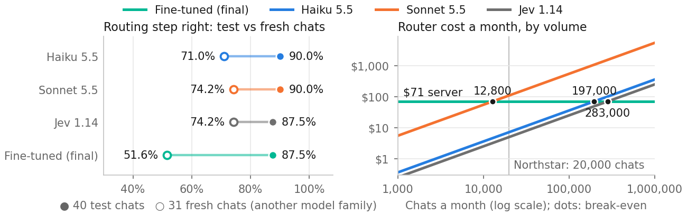

# Page 4. Fine-tuned router against a small and a large prompted model

**The task.** The router labels every chat: request type (10 labels), person needed or not, the reason (it picks the team), language. Narrow and run on every chat: the place for a small trained model.

**How it was built.** XLM-RoBERTa base (278 million weights, multilingual). A first version, fully fine-tuned on 130 chats, reached 67.5% on request type and 40.0% task success in the agent. The study then chose everything by cross-validation on the 160 training and validation chats (5 folds by customer, 3 seeds): first message as input, LoRA (0.3 million trained weights), 60 epochs, and an attack answer, since the data has no reason labels. All was frozen before one scoring of the test and fresh chats. Haiku and Sonnet used the team's prompt; Jev got its rules too.

| On the 40 test chats | Fine-tuned | Haiku 5.5 (small) | Sonnet 5.5 (large) | Jev 1.14 |
|---|---|---|---|---|
| Request type right (95% range) | 80.0% (69 to 90) | 82.5% (70 to 93) | 82.5% (69 to 93) | **90.0%** (81 to 98) |
| Routing step right | 87.5% | **90.0%** | **90.0%** | 87.5% |
| Needed handoffs flagged | 16 of 18 | **18 of 18** | **18 of 18** | **18 of 18** |
| 31 fresh chats: type right | 54.8% | 87.1% | **90.3%** | 87.1% |
| Median time per chat | 0.74 s, on a CPU | 2.34 s | 1.00 s | **0.46 s** |
| Cost per 1,000 chats | **$0**, plus a server | $0.32 | $5.37 | $0.25 |
| Task success, whole agent | 57.5% | **70.0%** | 65.0% | 55.0% |

<!-- figure width: 5.9 in -->

**Why it lost, and where it wins.**
- **Too little data.** About 13 training chats per request type; on fresh chats from another model family it fell to 54.8%.
- **Reasons.** Read from the request type, 7 of 31 attacks reached the right team in cross-validation; the attack answer raised it to 25. In the agent it lost 5 chats to Haiku and won none (p = 0.063), mostly roadside chats Haiku flags as safety.
- **Wins.** 3 times faster than Haiku, no cost per chat, 6 MB of trained weights, and the chat stays on the dealer's server.

**Jev.** Cheap, it answers typed questions. Bare, it routed 80.0% of training chats right; with the prompt's rules and examples, 90.0%, level with Haiku. In the agent: 55.0% on test (lost 6, won none, p = 0.031), 61.3% on fresh chats against Haiku's 67.7% (p = 0.63). The closest cheaper option, not better.

**When fine-tuning pays.** One CPU server is $71 a month, so it beats Haiku on cost above 197,000 chats a month, Jev above 283,000 and Sonnet above 12,800 (right chart). In the agent it costs $0.0007 more a chat and finishes 2.5 points fewer alone and correctly. Verdict: Haiku stays. Retry with a few hundred chats from several sources, reason labels and a volume near 200,000 chats a month.
