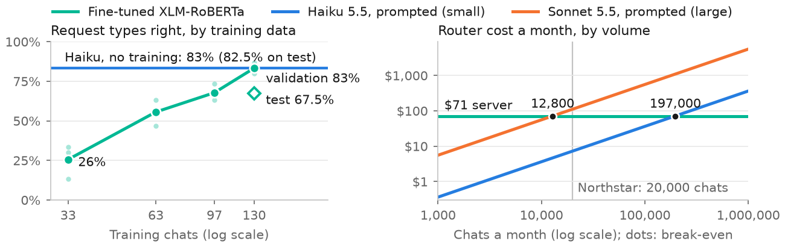

# Page 4. Fine-tuned router against a small and a large prompted model

**The task.** The router labels every chat: request type (10 labels), person needed or not, language. Narrow, clearly labelled and run on every chat: the place to try a small trained model, not a paid call.

**How it was built.** XLM-RoBERTa base (278 million weights, multilingual) with three small heads, trained on 130 chats. Every choice used the 30 validation chats: base model (DistilBERT scored lower; mDeBERTa crashed), learning rate (3e-5, of three), handoff cut-off (favouring recall), and full fine-tuning over LoRA (macro F1 0.75 against 0.70, handoff recall 93% against 80%). At most 30 epochs, early stopping, batch 16, AdamW, weight decay 0.01, dropout 0.2; 16 GPU minutes in all. The test chats were scored once, with the prompted routers' input and scoring.

| On the 40 test chats | Fine-tuned | Haiku 5.5 (small) | Sonnet 5.5 (large) |
|---|---|---|---|
| Request type right (95% range) | 67.5% (52 to 80) | **82.5%** (68 to 91) | 77.5% (62 to 88) |
| Needed handoffs flagged | 16 of 18 | **18 of 18** | 17 of 18 |
| Median time per chat | **249 ms**, on a CPU | 2,443 ms | 1,047 ms |
| Cost per 1,000 chats | **$0**, plus a server | $0.36 | $5.56 |
| Task success, whole agent | 40.0% | **70.0%** | 65.0% |

<!-- figure width: 5.9 in -->

**Why it lost, and where it wins.**
- **Too little data.** About 13 training chats per request type; five training runs ranged from 62.5% to 75% on test. Accuracy still rises about 28 points each time the data doubles (left chart): about 190 chats would close the gap if the trend held, so plan for a few hundred.
- **Attacks.** 3 of 9 attack chats labelled right (Haiku 6, Sonnet 7); both handoffs it missed were attacks.
- **No handoff reason.** The data has no reason labels, so a fixed rule picks the queue. In the whole agent 8 of its 17 needed handoffs went to the wrong queue; the agent lost 12 chats and won none (p = 0.0005). On request type alone the gap to Haiku is not clear (p = 0.15).
- **Wins.** 10 times faster than Haiku, no cost per chat, and the chat stays on the dealer's server.

**When fine-tuning pays.** One CPU server is $71 a month, so it beats Haiku on cost above 197,000 chats a month and Sonnet above 12,800 (right chart). At Northstar's 20,000 the Haiku router costs $7 a month. Cost is not the real test: in the agent it saves $0.0025 a chat but finishes 10 points fewer chats alone and correctly, worth $0.27 a chat in people's time. Verdict: not now. Retry with a few hundred labelled chats, reason labels, and a group volume near 200,000 chats a month or a rule keeping chats in-house.
