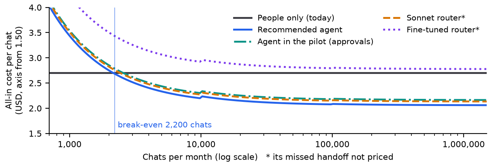

# Page 7. Economics: is the agent worth it?

**Business case.** Today a person answers every chat: 8.4 minutes at C$21.50 an hour plus 25% payroll costs, or **$2.70 a chat** with their own broken promises. The agent finishes 35% of chats alone and correctly and hands 60% to a person with a summary, at any hour: **$2.08** a chat all in at 100,000 chats.

| Chats a month | People only | Agent, all in | Of which model calls | Saving |
|---|---|---|---|---|
| 1,000 | $2,703 | $3,435 | $17 | -$732 (-27%) |
| 20,000 (Northstar) | $54,065 | $42,979 | $336 | $11,086 (+21%) |
| 100,000 | $270,327 | $207,698 | $1,682 | $62,629 (+23%) |
| 1,000,000 | $2,703,272 | $2,061,773 | $16,821 | $641,498 (+24%) |

<!-- figure width: 6.0 in -->

**What is in the cost.** Model calls (3 replies a chat, 5% retries) are under 1%. People are most of it: chats handed off, chats that come back, a 5% review sample. Then mistakes at their measured rate, two servers, monitoring, 10 to 40 engineering hours a month and the build paid back over 24 months. Per successful chat: people $3.85, recommended agent **$2.97**. The other options cost more even before their missed handoff is priced at $500 (assumption): $2.15 a chat with a Sonnet router, $2.79 fine-tuned, $2.97 as a single agent.

| Break-even | Value | Evidence so far |
|---|---|---|
| Volume | 2,200 chats a month | Fixed costs about $1,400 a month |
| Expensive promise ($847) | 0.074% (1 in 1,350) | 0 in 185: proven only below 2.0% |
| Finished alone and correctly | 14.1% at 20,000 chats | 35% on test, 9.7% on fresh chats |
| Automated warranty approval | 1 wrong in 134 | Not automated |
| Fine-tuned router | 197,000 chats a month | Router alone; never in the agent |

**A bigger model pays** if it avoids one mistake every 32,000 chats for the router, every 107 for bookings (Haiku kept: it avoided none), every 16,000 for billing (Sonnet kept), every 1.3 million for high warranty effort (medium kept).

**How sure are we?** At the fresh-chat rates the saving at 20,000 chats falls from $11,086 to $1,291 (+2%) and the pilot month from +$1,333 to -$1,214; with the two missed handoffs at $500 each it is a loss of $643,870. Drawing every rate from its uncertainty, the chance of saving money is 14% as built, 40% with approvals and 82% after a clean 5,000-chat pilot: hence a gated pilot, not a full launch.
